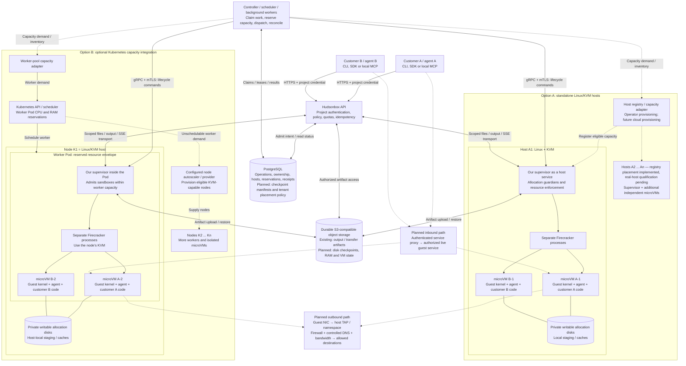

# Architecture v1: standalone and Kubernetes deployment

Snapshot: 2026-10-30. This is the target deployment view discussed for [release tracker #177](https://github.com/hudson-frontier/hudsonbox/issues/177), not a report of a production deployment or completed release. The standalone foundation exists. Registry-based multi-host placement, per-owner routing, host-loss reconciliation and static standalone capacity operations are implemented, with portable fake-supervisor evidence only; supported two-host Linux/KVM qualification has not been run. An optional Kubernetes worker capacity adapter is implemented; real Kubernetes/KVM qualification, durable checkpoints and the complete tenant model remain incomplete.

[Architecture](architecture.md) remains authoritative for component boundaries; [lifecycle](lifecycle.md), [networking](networking.md), [authentication](auth-design.md) and [roadmap](roadmap.md) own their detailed contracts. This snapshot explains how the two deployment options fit together without making Kubernetes a customer prerequisite.

## One API, two deployment paths

Clients use the same HTTPS API through the CLI, Rust/Python/TypeScript SDKs or optional local MCP adapter. They address sandbox and operation IDs, not hosts. Hudsonbox owns sandbox admission, placement and lifecycle; a deployment adapter supplies eligible execution capacity.

Solid connections describe component relationships, not implementation-completion claims. Dashed connections show provisioning, inventory or planned network relationships. The two columns are alternative deployment choices, not a requirement to operate a mixed fleet. Example placement shares hosts between customers; dedicated placement would restrict a customer's allocations to assigned hosts. Each depicted allocation disk is private even though disks are grouped into one storage symbol per host.

A worker Pod packages the supervisor and host-side Firecracker processes. Customer code still runs in separate guest kernels behind Firecracker/KVM. Kubernetes does not replace that isolation boundary. A cloud VM used as a host must expose usable KVM/nested virtualization; not every VM type is suitable.

## Create and execute paths

1. The client submits an approved image, resource request and stable idempotency key. The API authenticates the project, checks policy and persists an operation. It returns an operation ID; admission is not readiness.
2. The controller claims the operation and reserves eligible capacity. The implemented fleet placement also checks approved host capabilities and shared/dedicated pool access; snapshot/cache locality remains proposed.
3. **Standalone:** select an existing registered host. Operators initially provide capacity; a future provider adapter may add hosts under explicit configuration.
4. **Kubernetes:** select an existing ready worker. The optional capacity adapter creates bounded worker Pods from explicit durable intents and resource budgets. A separately configured node autoscaler can add eligible nodes when those Pods cannot fit. Sandbox demand must be translated into worker demand; Kubernetes cannot infer it from out-of-band Firecracker processes.
5. The supervisor validates ownership and capacity independently, records intent, prepares private disks and launches the guarded Firecracker allocation. Kubernetes packaging must preserve guardian watchdogs, ownership fencing, host limits and cleanup rather than bypass them.
6. The guest boots and authenticates over vsock. A matching live guest handshake establishes readiness; merely observing a Firecracker process does not.
7. Execute requests follow API → PostgreSQL → controller → supervisor → vsock → guest agent → customer process. Files and output use scoped API/supervisor/guest paths, with object storage for artifacts; bulk bytes bypass the controller work queue. The client can reconnect using the same operation handle.

One controller places creates across every registered, healthy and compatible host and routes each later request to the allocation's persisted owner ([placement](controller.md#placement), [owner routing](controller.md#per-owner-host-routing)). A host without a registered transport keeps the legacy configured single-host path. [Portable fleet qualification](evidence/2026-10-30-fleet-qualification.md) runs two simulated supervisors with several allocations each; supported two-host Linux/KVM concurrency, isolation and failure qualification has not been run.

## Capacity and lifecycle authority

PostgreSQL remains the durable authority for sandbox operations, reservations, ownership and outcomes in both options. Rust controller reconciliation handles asynchronous work. Proposed checkpoint/upload/restore handlers extend that operation model; this design requires neither Temporal nor Redis inside Hudsonbox. A caller can orchestrate its own workflows independently.

In Kubernetes mode, Kubernetes owns worker/node capacity and placement. Our controller owns individual sandbox placement; the supervisor owns local atomic admission and physical enforcement. Worker resource requests must account for VM budgets plus runtime overhead, and admission must stay within the reservation. There must not be two independent schedulers spending the same capacity or competing Kubernetes and PostgreSQL authorities for sandbox lifecycle.

Scale-down must prevent new placements, drain or explicitly stop existing work, confirm cleanup and release reservations before removing workers or nodes. Pod eviction, node maintenance and provider termination require coordination; Kubernetes node removal is not evidence that VM state was saved. External interruption can still cause failure.

## Storage and checkpoint recovery

- **PostgreSQL:** identities, authorization metadata, durable operations, host ownership, resource reservations and receipts. Checkpoint manifests/publication state are planned; bulk memory and disk bytes do not belong in database rows.
- **Compute-host disk:** each running sandbox's private writable filesystem, staging and bounded caches. Shared immutable bases and copy-on-write allocation disks are proposed optimizations; the current bootstrap copies the rootfs into private writable storage.
- **S3-compatible object storage:** existing retained-output and file-transfer artifacts; future immutable checkpoint components and associated manifests. Development uses MinIO. Production durability must be independent of compute-host loss; MinIO on the same machine and disk does not provide that failure boundary. Database recovery also needs independent backup and authority reconciliation.

Checkpoint capture and upload are separate from durable publication. A locally captured checkpoint or accepted background upload cannot be reported as host-loss-safe before all required components are uploaded, integrity-verified and durably published.

**Disk-only recovery** boots a replacement VM with saved files; processes restart. **Full pause/resume** additionally saves compatible memory and VM state and follows the guest freeze/handshake/release protocol in [lifecycle](lifecycle.md). Work after the last durable checkpoint can be lost. Restoring a snapshot does not undo external API calls or make arbitrary execution exactly-once.

After host failure, establish termination or fencing of the old allocation before permitting a replacement. Select a compatible eligible host, verify checkpoint integrity and project ownership, restore with current authorization/network policy and original deadlines, and record the new allocation. Unknown customer-command outcomes must not trigger blind replay.

## Networking and tenant isolation

The current development microVM integration has no NIC. Commands and file transfers still work over vsock. Host-enforced outbound networking is planned: guest NIC → TAP/per-allocation namespace → firewall, controlled resolver and bandwidth enforcement → approved destinations. Protected host/platform, metadata and other-sandbox destinations remain denied. The full contract belongs to [networking](networking.md).

Authenticated ingress is a separate proposed capability: an authorized client reaches an explicitly registered guest service through a proxy. Routes must be bound to the current project/allocation/boot and revoked on teardown; guest content must not share the management origin.

VM isolation and tenant isolation are different responsibilities. Existing project-scoped authorization is a foundation, not a complete organization/customer model. The target requires ownership checks for all sandboxes, files, snapshots and operations, host-enforced networking, and placement policy for shared or dedicated hosts. Object names alone are not access control. Guests receive no platform PostgreSQL or object-store credentials.

Open-source and proprietary offerings need the same isolation baseline. Self-hosters provide hosts and storage; a future hosted offering supplies them on the customer's behalf. Managed provisioning, billing, enterprise identity and dedicated-host administration are possible commercial services, not substitutes for core access control. Packaging and commercial scope remain product decisions.

## Status and next implementation boundaries

- **Implemented foundation:** authenticated API and clients, PostgreSQL operations, supervisor/guardian, real guest execution, files, output and cancellation, with controlled development evidence. The controller adds registry-based multi-host placement with shared/dedicated pool access, per-owner routing, host-loss reconciliation without premature release, and static standalone capacity operations; their evidence is portable fake-supervisor and PostgreSQL testing only.
- **Incomplete qualification:** supported-host security/resource/concurrency gates, the [operator two-host Linux/KVM procedure](evidence/2026-10-30-fleet-qualification.md#operator-two-host-linuxkvm-qualification-not-run) (not run), production images, complete cleanup/reclamation and independent operator installation.
- **Proposed extensions:** durable checkpoints/full pause-resume and checkpoint-based host-loss recovery (#178), network enforcement and guest ingress, qualified Kubernetes worker packaging, cloud host provisioning and complete tenant administration. Warm-pool runtime qualification remains incomplete.

The API/controller themselves can run as ordinary services or Kubernetes Deployments; their packaging does not determine the sandbox isolation boundary. Detailed delivery is tracked in [#177](https://github.com/hudson-frontier/hudsonbox/issues/177) and its sub-issues. This document supplies no deployment, infrastructure-purchase or release authorization.

## Accepted fleet and warm-pool models

The [accepted v1 data model](data-models.md#accepted-v1-fleet-and-warm-pool-model) locks host pools, immutable sandbox templates, warm-pool policies/members and durable capacity operations as the implementation baseline. `host_pools.type` is exactly `k8s` or `standalone`; the provider router selects the corresponding capacity/discovery adapter. Controller-to-supervisor communication remains gRPC/mTLS in both paths. Registry/pool migrations and [static standalone capacity operations](host-maintenance.md#standalone-durable-capacity-operations) implement part of this baseline. The [optional Kubernetes adapter](kubernetes-capacity.md) implements worker capacity intent and discovery, with cluster/KVM qualification still open. [Warm pools](warm-pools.md) implement templates, fenced reservations, supervisor RPCs and bounded upkeep; supported runtime qualification remains incomplete.
